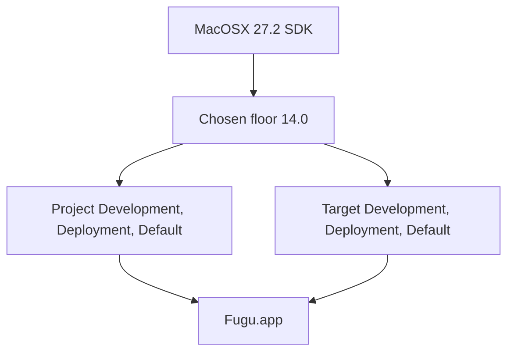

# Architecture Decision: Xcode 27 deployment target

📌 CREATIVE PHASE START: deployment target
━━━━━━━━━━━━━━━━━━━━━━━━━━━━━━━

## 1. Problem

`MACOSX_DEPLOYMENT_TARGET` is `12.0` in all six configurations. Xcode 27.2 recommends `14.0`. The Mac platform `MinimumSDKVersion` is `14.0`. The macOS 27.2 SDK version is `27.2`, which is not the recommended floor.

A Development build at `12.0` succeeded on 8 Nov 2026, so the compiler still accepts that floor. The built app can still launch on macOS 12 and 13. The upgrade has to pick one explicit number. The plan forbids `$(RECOMMENDED_MACOSX_DEPLOYMENT_TARGET)` because that macro moves when Xcode does.

Requirements:

- One literal deployment target in the project configurations and the Fugu target configurations.
- The number is a floor Xcode 27.2 still supports.
- The choice is stable across the next Xcode update.
- No `Info.plist` key is added. The build setting remains the floor.

Constraints:

- Raising the floor can turn an API that existed only before the new floor into a compile error.
- This task does not rewrite controllers. A failure is fixed only at the lines the build names.

## 2. Options

- Option A: Keep `12.0`.
- Option B: Set `14.0` on all six configurations.
- Option C: Set `27.2`, the SDK version, on all six configurations.

The recommended macro is not a fourth product choice. It equals `14.0` on this Xcode and becomes a different number later without a review.

## 3. Analysis

| Criterion | A keep 12.0 | B pin 14.0 | C pin 27.2 |
| --- | --- | --- | --- |
| Launches on macOS 12 and 13 | Yes | No | No |
| Matches `RECOMMENDED_MACOSX_DEPLOYMENT_TARGET` | No | Yes | No |
| At or above platform `MinimumSDKVersion` 14.0 | No | Yes | Yes |
| Stays put on the next Xcode | Yes | Yes | Yes |
| Compile risk against today's tree | None. The 8 Nov 2026 build passed | Availability errors only if a call is unavailable on macOS 14 | Same class of risk, plus a much smaller set of Macs that can run the app |
| What the upgrade asked for | Leaves the leftover floor | Matches the Xcode 27 recommendation | Matches the SDK version, which the toolchain does not require |

Option A keeps older Macs and leaves the project under both numbers Xcode 27 publishes as the floor. The successful build shows that this is still legal, not that it is the upgraded setting.

Option C matches this development Mac and refuses every earlier release. Nothing in the compiler, the recommended setting, or the platform minimum asks for that.

Option B is the only value that is explicit, stable, and equal to both the recommendation and the platform minimum. Dropping macOS 12 and 13 is the cost of that match.

## 4. Decision

Selected: Option B. `MACOSX_DEPLOYMENT_TARGET` is `14.0` in all six configurations.

Rationale: The upgrade is to the Xcode 27.2 toolchain. That toolchain's recommended deployment target and the platform minimum are both `14.0`. `12.0` still compiles and is the setting being replaced. `27.2` would cut off every Mac that is not on this SDK. The macro is rejected because it hides the same `14.0` today and can change it later.

## 5. Implementation notes

- Write the literal `14.0` in project Development, Deployment, and Default, and in target Development, Deployment, and Default.
- Do not insert `$(RECOMMENDED_MACOSX_DEPLOYMENT_TARGET)`.
- Do not add `LSMinimumSystemVersion` to `Info.plist`.
- Do this in the same edit as `LastUpgradeCheck` `2720` and the removal of `CC`, `CPLUSPLUS`, and `ZERO_LINK`.
- If the new floor produces errors, change only the cited lines. Do not lower the floor to silence them.

## 6. Validation

- `-showBuildSettings` for Development reports `MACOSX_DEPLOYMENT_TARGET = 14.0`.
- Development, Deployment, and Default each print `** BUILD SUCCEEDED **`.
- The built app requires macOS 14.0. macOS 12 and 13 are out of support for this product.

━━━━━━━━━━━━━━━━━━━━━━━━━━━━━━━
📌 CREATIVE PHASE END
