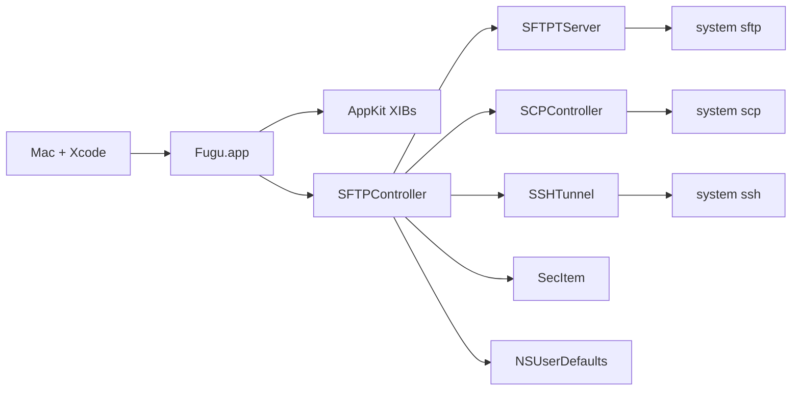

# Task: Fugu Objective-C to Swift migration

## Description

Move Fugu from a flat Objective-C/C AppKit app to idiomatic Swift in a feature-based layout, without changing behavior. Each step compiles on its own. Development and every build stay on the local Mac that has Xcode. Step 1 is archived. Steps 2–6 are the remaining work.

## Complexity

Level: 4
Type: Complex System

## Development host

The Mac with Xcode is the only development machine.

- Edit, branch, build, run, and smoke-test in the Mac checkout.
- Do not compile or run Fugu from the Linux cloud agent. `xcodebuild` is not installed there, and a Linux build would not prove the Mac app.
- Branch names on the Mac follow the migration spec: `migrate/step-<NN>-<short-description>`.
- The shared scheme is user-local today (`Fugu.xcodeproj/xcuserdata/.../Fugu.xcscheme`, gitignored). A stale user scheme named `externaleditor` points at a target that is no longer in the project. Ignore it.

Mac baseline, before any migration branch:

```bash
cd /path/to/fugu
xcodebuild -project Fugu.xcodeproj -scheme Fugu -configuration Development build
```

If Xcode says the scheme is missing, open the project, choose Product → Scheme → Manage Schemes, and mark Fugu shared. Commit that shared scheme from the Mac. Then run the app from Xcode and confirm the dual-pane window opens.

## Technology Stack

- Framework: AppKit (Cocoa). Not UIKit. Not SwiftUI in the foundation steps.
- Build tool: Xcode on the Mac. Project file `Fugu.xcodeproj`. Configurations Development, Deployment, Default.
- Language: Objective-C and C remain until each file is migrated. Swift 6 is set (`SWIFT_VERSION = 6.0`). Step 1 added `App/FuguSwiftBridge.swift`.
- Deployment: macOS 11.5. Leave it.
- Storage: `NSUserDefaults`, login keychain via `SecItem`, remote state in OpenSSH subprocesses.
- Packages: none. No CocoaPods, Carthage, or Swift package is linked. Do not add one in Steps 1–3.

## Technology Validation Checkpoints

- [x] Stack defined from the existing project (AppKit, Swift 6 setting, ARC already on)
- [x] Mac build command documented above
- [x] Dependencies identified: Cocoa, Security, CoreServices, CoreFoundation, system `ssh` / `sftp` / `scp`
- [x] Baseline `xcodebuild` run on the Mac (required before Step 1 edits)
- [x] Step 1 Swift smoke file added and built on the Mac
- [x] Step 1 test build passes on the Mac
- [ ] Test build passes on the Mac after each later migration branch

## Build log

Mac, 5 Nov 2026. Xcode 27.2 (27B52). `uname -s` → Darwin.

Baseline, before the branch:

```text
xcodebuild -project Fugu.xcodeproj -scheme Fugu -configuration Development build
→ BUILD SUCCEEDED
```

The working tree already had uncommitted Xcode edits (app icon, `LastUpgradeCheck` 2720, deployment target `$(RECOMMENDED_MACOSX_DEPLOYMENT_TARGET)`). Step 1 did not add those. `CC` and `ZERO_LINK` were not changed.

After Step 1, the same command succeeded again. The log contains `SwiftCompile` of `App/FuguSwiftBridge.swift`. New nullability warnings were fixed until that build reported none. Pre-existing `iconForFileType:` deprecation warnings remain.

Launch: `Build/Products/Development/Fugu.app` shows the main window, 1175×775, titled `MacBook-Air.fritz.box (localhost): disconnected`. The local pane lists the home folder. Preferences opened as `Fugu Preferences: General`. SCP opened as `Secure Copy File`. The tunnel command opened `Create SSH Tunnel`. Connect, list, upload, and download still need an SSH host.

## Status

- [x] Initialization complete (VAN)
- [x] Planning complete
- [x] Creative decisions (`/creative`)
- [x] Technology build gate on the Mac
- [x] Step 1 archived. See `memory-bank/archive/archive-step-01.md`.
- [ ] Steps 2–6
- [x] Reflection for Step 1 (`memory-bank/reflection/reflection-step-01.md`)
- [x] Archive for Step 1
- [x] VAN re-entry, 6 Nov 2026. Platform macOS, path `/`, shell zsh. Complexity stays Level 4.
- [x] Step 2 plan confirmed, 6 Nov 2026. Steps 3–6 were not rewritten.

The six-step migration is not complete. Step 1 still has two gaps, recorded in the archive: the unstaged project wiring, and the SSH connect / list / upload / download smoke. Those gaps block `/build` for Step 2. No new creative phase is required.

## Archive

- **Date**: 6 Nov 2026
- **Archive Document**: `memory-bank/archive/archive-step-01.md`
- **Status**: Step 1 archived. Steps 2–6 are open.

## Architecture

One application target, `Fugu` (`edu.umich.fugu`). `NSApplicationMain` loads `MainMenu.xib`. `SFTPController` is the app delegate. Transfers call system OpenSSH in-process. Listings are dictionaries. UI is four English XIBs plus AppKit subclasses.



Selected shape for the migration:

- Stay one AppKit target. Add Swift beside Objective-C with a bridging header and `Fugu-Swift.h`.
- Keep system OpenSSH as the protocol engine unless a later creative decision says otherwise.
- Introduce typed models only when Objective-C callers can still see them.
- Reorganize disks folders to match real features. Do not invent empty ViewModel or Models trees.
- Verify every branch on the Mac before the next branch.

### Subsystems

| Subsystem | Files | Migrates in |
| --- | --- | --- |
| Project and interop | `project.pbxproj`, headers, new Swift probe | Step 1 |
| Leaf utilities | Categories, `keychain.c`, `UMVersionCheck`, `UMFileLauncher` | Steps 2–3 |
| Listings and constants | `#define`s, dictionary rows | Step 3 |
| Transfer engine | `SFTPTServer`, `SCPTransfer`, `SSHTunnelAuth`, C spawn helpers | Step 4 |
| Screens | `SFTPController`, prefs, SCP window, tunnel window, browser subclasses, XIBs | Step 5 |
| Lifecycle | `main.m`, bridging cleanup | Step 6 |

### Integration points that must keep working

- XIB outlets and actions on `SFTPController`, `SFTPPrefs`, `SCPController`, `SSHTunnel`.
- Services menu message `secureCopyFile`.
- Keychain items already stored with `SecItem`.
- Temp directory `/private/tmp/Fugu`.
- ODB editor Apple Events (`aevent.c`, `ODBEditorSuite.h`).
- Version plist at `VERSION_URL` in `UMVersionCheck.h`.
- Gestalt-packed OS version from `NSWorkspace(SystemVersionNumber)` until callers change.

## Implementation Plan

Each step is its own branch, created on the Mac, and merged only after that Mac build and smoke test pass.

### 1. `migrate/step-01-project-structure-and-bridging`

Archived 6 Nov 2026. Detail is in `memory-bank/archive/archive-step-01.md`.

Before Step 2:

- [ ] Commit the unstaged `project.pbxproj` group paths and module settings, and the header nullability. `c3bdfcc` has the moves and the Swift probe only. Keep the pre-existing icon and deployment-target edits out of that commit unless they are chosen on purpose.
- [ ] SSH smoke: connect, list, upload, download. Launch, preferences, SCP, and the tunnel sheet already passed.

### 2. `migrate/step-02-spm-and-native-replacements`

Impact: low. Confirmed 6 Nov 2026. No new package. No new creative phase. Branch from the Mac checkout only after the two Step 1 gaps are closed.

Technology for this step is already proven: AppKit, Swift 6, `SecItem`, `FileManager`. `App/FuguSwiftBridge.swift` is the proof that the target compiles Swift. Step 1's Development build is the test build. Step 2 adds no dependency and does not change `CC` or `ZERO_LINK`.

Do not touch `argcargv`, `fdwrite`, `ee.c`, `sshversion.c`, or `typeforchar.c`. They stay with the process engine.

Temp directory:

- Call sites are only `Features/SFTP/SFTPController.m` (`makeTemporaryDirectoryWithMode:` at the preview and edit paths, mode `0700`). Quit cleanup in the same file uses its own `C_TMPFUGUDIR` and `OBJC_TMPFUGUDIR` defines. Leave those defines.
- Add `Core/Support/FuguTemporaryDirectory.swift` to the app target. It creates `/private/tmp/Fugu` with `FileManager` at mode `0700`, then keeps `mkdtemp` on `tmp.XXXXXX`. `FileManager` has no equivalent of `mkdtemp`.
- Return nil on failure and set `errno` from the POSIX error so the existing `mkdir: strerror(errno)` alert stays true.
- Delete `Core/Categories/NSFileManager(mktemp).h` and `.m` only after those two call sites compile against the Swift helper and nothing else imports the header.

Keychain:

- `Core/C/keychain.c` already uses `SecItemCopyMatching` and `SecItemAdd` for a generic password. Service is the host, account is the user name. `getpwdfromkeychain` returns malloc'd bytes and an `OSStatus`. Not-found is `errSecItemNotFound`. `addpwdtokeychain` ignores `errSecDuplicateItem` after a syslog line. Do not change that behavior.
- Add `Core/Support/FuguKeychain.swift`. It calls those two C functions. It does not reimplement `SecItem`. The C functions stay, because `SFTPController`, `SCPController`, and `SSHTunnel` remain Objective-C.
- Point the six call sites at the Swift type: `retrievePasswordFromKeychain` and `addPasswordToKeychain` in `Features/SFTP/SFTPController.m`, `Features/SCP/SCPController.m`, and `Features/SSHTunnel/SSHTunnel.m`. The Swift read method must still surface `OSStatus`, including `errSecItemNotFound`, and it must `free` the C buffer after copying it into a `String`.

Checks:

- [ ] Step 1 gaps closed first: project wiring committed, then connect, list, upload, download. Still open. The Step 2 branch was created from `c3bdfcc` anyway, so those edits are uncommitted on this branch too.
- [x] New branch `migrate/step-02-spm-and-native-replacements`.
- [x] `Core/Support/FuguTemporaryDirectory.swift` and `Core/Support/FuguKeychain.swift` are in the Fugu target Compile Sources. `NSFileManager(mktemp)` is removed.
- [x] Development `xcodebuild` succeeds (6 Nov 2026, Xcode 27.2, BUILD SUCCEEDED). `SwiftCompile` includes both new files. New warnings: none. Existing `iconForFileType:` deprecations remain.
- [ ] Preview or external edit still creates a directory under `/private/tmp/Fugu`.
- [ ] Password save and password fill still work for the SFTP connect sheet. The same C item is what SCP and the tunnel read.
- [ ] Quit still removes `/private/tmp/Fugu` when that directory is writable.

### 3. `migrate/step-03-models-and-constants`

Impact: low-medium.

- [ ] Move toolbar and column `#define`s into Swift enums exposed to Objective-C where the nib or Objective-C still reads them.
- [ ] Add a remote-entry type for `sftp` listing lines. Keep an `@objc` dictionary bridge while `SFTPController` is Objective-C.
- [ ] Migrate date, icon, encoding, alias, and OS-version categories.
- [ ] Delete a `.h`/`.m` pair only after the Mac build no longer references it.

### 4. `migrate/step-04-services-and-networking`

Impact: medium. Blocked on the process-engine creative decision.

- [ ] Move `SFTPTServer`, `SCPTransfer`, and `SSHTunnelAuth` to Swift.
- [ ] Drive `sftp`, `scp`, and `ssh` with `Process` (or keep the current `fork` path behind a Swift type until parity is proven).
- [ ] Expose completion-handler methods for any Objective-C caller that remains.
- [ ] Move `UMVersionCheck` to `URLSession` and `PropertyListDecoder`.
- [ ] Mac: connect, cancel, resume a listing, upload, download, SCP, and a local forward.

### 5. `migrate/step-05-ui-and-viewcontrollers`

Impact: medium-high. One screen per sub-branch, each built on the Mac.

- [ ] `migrate/step-05a-browser-views` — table, split, scroll, cell, image preview.
- [ ] `migrate/step-05b-preferences` — `SFTPPrefs` and `Prefs.xib`.
- [ ] `migrate/step-05c-scp` — `SCP.xib`.
- [ ] `migrate/step-05d-tunnel` — `SSHTunnel.xib`.
- [ ] `migrate/step-05e-main-window` — `SFTPController` and `MainMenu.xib` last.
- [ ] Update XIB custom-class module names to `Fugu`.
- [ ] Stay on AppKit. Dynamic Type, safe areas, and dark mode are follow-on checks, not a SwiftUI rewrite.

### 6. `migrate/step-06-app-lifecycle-and-cleanup`

Impact: high. Last branch.

- [ ] Replace `main.m` with an `@main` AppKit delegate.
- [ ] Drop `@objc` and `NSObject` from Swift types that XIBs and Objective-C no longer touch.
- [ ] Remove the bridging header when the last `.h`/`.m` is gone.
- [ ] Mac: full smoke pass, then quit and confirm no leftover `sftp`, `scp`, or `ssh` child.

## Creative Phases Required

- [x] Step 1 layout. Decision: move files, set group `path`, keep file-reference filenames and `#import` lines. `Info.plist` stays at the root. See `memory-bank/creative/creative-step1-layout.md`.
- [x] Step 1 nullability. Decision: assume nonnull on methods only. `IBOutlet` ivars stay `_Nullable`. See `memory-bank/creative/creative-step1-nullability.md`.
- [x] Step 1 probe. Decision: `App/FuguSwiftBridge.swift` in the app target. No XCTest target yet. See `memory-bank/creative/creative-step1-swift-probe.md`.
- [x] Listing model. Decision: add `RemoteEntry` with a lossless dictionary bridge. Parser output stays a dictionary until Step 4. See `memory-bank/creative/creative-listing-model.md`.
- [x] Process engine. Decision: keep system OpenSSH. Swift wraps the current spawn path. No SSH package. See `memory-bank/creative/creative-process-engine.md`.
- [x] Screens. Decision: AppKit only, in the order browser, preferences, SCP, tunnel, main window. No SwiftUI and no visual redesign in the port. See `memory-bank/creative/creative-ui-migration.md`.
- [x] `@main`. Decision: Swift `NSApplicationMain` after Steps 1–5. The nib keeps the delegate. Remove the bridging header only when Swift imports no project `.h`. See `memory-bank/creative/creative-app-lifecycle.md`.
- [x] Step 2 temp directory and keychain. Decided in this plan, no separate creative file. `FileManager` creates `/private/tmp/Fugu`; `mkdtemp` stays for the unique child. `FuguKeychain` calls the existing `SecItem` C functions. No new package.

## Dependencies

- Mac with Xcode, and the system `ssh`, `sftp`, and `scp` binaries.
- Existing Fugu checkout on that Mac. That checkout is the build tree.
- A reachable SSH host for manual transfer checks. No automated test target exists.
- Login keychain access for password round-trip checks.
- Step 4 depends on the process-engine creative decision.
- Step 5 depends on `PRODUCT_MODULE_NAME = Fugu` from Step 1.
- Step 6 depends on Steps 1–5 leaving no Objective-C caller that still needs the bridging header.

## Challenges & Mitigations

- Linux cannot prove a Mac build. Mitigation: no migration edit is "done" until the Mac `xcodebuild` and the smoke list pass. The cloud agent does not substitute a build.
- Moving files breaks the project if group paths and build phases disagree. Mitigation: Step 1 is path-only. Creative phase writes the exact `pbxproj` rules before the move.
- `SFTPController.m` is thousands of lines and nib-coupled. Mitigation: it stays Objective-C until Step 5e, after the smaller screens.
- Nullability can mark outlets nonnull too early. Mitigation: creative phase lists which pointers stay `nullable`.
- No tests. Mitigation: each branch has a written Mac smoke checklist. A test target is optional and not a Step 1 requirement.
- Stale `externaleditor` scheme. Mitigation: do not revive that target. Build the Fugu scheme only.
- `CC = /usr/bin/gcc` and Development `ZERO_LINK = YES` are leftovers. Mitigation: leave them until a dedicated build-settings change, after a clean Mac baseline.
- Step 2 can drop `errno` if the temp helper uses only `FileManager`. Mitigation: keep `mkdtemp`, and set `errno` when the parent directory create fails.
- A Swift keychain rewrite can change not-found and duplicate-item behavior. Mitigation: leave `keychain.c` as the `SecItem` implementation. The Swift type forwards to it and still returns `OSStatus`.

## Requirements trace

Functional behavior that must survive every step: connect, authenticate, list, upload, download, mkdir, delete, rename, preview, edit via ODB, SCP window, Services `secureCopyFile`, SSH tunnel, preferences, keychain passwords, version check.

Non-functional: each branch builds on the Mac; no new third-party package by default; AppKit HIG for any UI work; passwords stay in the keychain; the app stays one process.

## Audit notes carried forward

`audit.md` is stale. The tree has ARC on, deployment target 11.5, no Carthage, and no `NSConnection`. Keychain is already `SecItem`. Alias resolution is already `NSURL`. `aevent.c` still uses `FSRef` / `FSSpec`. Detail from VAN remains valid for file names and roles.
