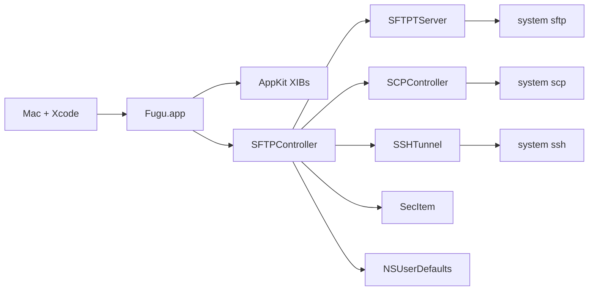

# Task: Upgrade the project to Xcode 27

## Description

Make `Fugu.xcodeproj` a consistent Xcode 27 project on this Mac (Xcode 27.2, build 27B52, macOS 27.2 SDK). The project already opens and the Development build has succeeded here. `LastUpgradeCheck` is already `2720`. The remaining gap is old project shape and contradictory build settings, not a missing Xcode install.

## Complexity

Level: 3
Type: Intermediate feature

## Requirements

- [ ] Project format, compiler selection, and deployment target are explicit and agree across the project and the Fugu target.
- [ ] Development, Deployment, and Default all build with the Xcode 27.2 toolchain.
- [ ] Obsolete settings that override that toolchain are removed: `CC = /usr/bin/gcc`, `CPLUSPLUS = /usr/bin/g++`, and `ZERO_LINK`.
- [ ] `MACOSX_DEPLOYMENT_TARGET` is one chosen value. Today the project level is `11.5` and the target level is `$(RECOMMENDED_MACOSX_DEPLOYMENT_TARGET)`, which the macOS 27.2 SDK resolves to `27.2`.
- [ ] A Development `xcodebuild` succeeds after the change.
- [ ] The Swift migration and the text-editor work stay as they are. This task does not rewrite controllers or switch `forkpty` to `Process`.

## Facts from this tree (8 Nov 2026)

- `objectVersion = 54`, `compatibilityVersion = "Xcode 12.0"`.
- `LastUpgradeCheck = 2720`. `LastSwiftMigration = 2640`.
- Project configs set `MACOSX_DEPLOYMENT_TARGET = 11.5` plus the Xcode 27 warning set (`ENABLE_USER_SCRIPT_SANDBOXING`, string catalogs, strict objc msgsend).
- Target configs override deployment to `$(RECOMMENDED_MACOSX_DEPLOYMENT_TARGET)` and pin `CC` / `CPLUSPLUS`. Development also sets `ZERO_LINK = YES`. Deployment sets `ZERO_LINK = NO`.
- SDK `DefaultProperties` `MACOSX_DEPLOYMENT_TARGET` is `27.2`. Platform `MinimumSDKVersion` is `14.0`.
- `SWIFT_VERSION = 6.0`. One target, `edu.umich.fugu`.

## Creative phase required

- [ ] Choose the deployment target: keep a floor the SDK still accepts (not below `14.0`), or adopt the SDK recommendation `27.2`.
- [ ] Decide whether `objectVersion` / `compatibilityVersion` move forward, or stay at the Xcode 12 format while settings are cleaned.

## Status

- [x] VAN, 8 Nov 2026
- [ ] PLAN
- [ ] Creative decision for deployment target and project format
- [ ] Implementation
- [ ] Development build on this Mac

## Parked: text editor setting

The File Editing work below is implemented and its Development build succeeded. In-app checks are still open. It is not this task.

# Task: Text editor setting

## Description

The File Editing preference offers a preferred text editor chosen from the editors installed on this Mac. The menu includes modern editors. The installed list is cached. A missing app does not appear. The Swift migration plan below stays parked and is not this build.

## Complexity

Level: 3
Type: Intermediate feature

## Requirements

- [ ] The File Editing popup lists editors that are installed on this Mac. An app that is not installed does not appear.
- [ ] The catalog includes the current ODB editors that are still installed, plus CotEditor, Nova, Sublime Text, Visual Studio Code, Cursor, Zed, MacVim, and TextEdit. `vi` and `emacs` stay when their binaries exist.
- [ ] The user chooses one editor. The choice is restored the next time the pane opens and the next time a file is edited.
- [ ] The installed list is written to `NSUserDefaults` on each visit to File Editing. If a scan returns nothing, the popup uses that cache.
- [ ] When `ODBTextEditor` is unset, or names an editor that is not installed, the selection is the first installed editor in the priority order. TextEdit is the last fallback. The default is no longer BBEdit when BBEdit is absent.
- [ ] A local file opens in the chosen app.
- [ ] A remote file opened in an editor that speaks ODB still uploads through the existing modified-file and closed-file events.
- [ ] Opening does not depend on a name match in `Resources/ODBEditors.plist`.

## Technology Stack

- Framework: AppKit. The existing `NSPopUpButton` stays. No SwiftUI.
- Lookup: `NSWorkspace` `URLForApplicationWithBundleIdentifier:`, already used by `NSWorkspace(LaunchServices)`.
- Launch: the existing `openFileURL:withApplicationURL:odbParams:completionHandler:`.
- Storage: `NSUserDefaults`. No new file and no new package.
- Language: a small Swift catalog in `Core/Support`, called from the existing Objective-C prefs and controller. `SFTPPrefs` stays Objective-C.
- Build: `xcodebuild -project Fugu.xcodeproj -scheme Fugu -configuration Development build` on this Mac.

## Technology Validation

- [x] Stack is the existing Fugu app. No project initialization.
- [x] Dependencies are AppKit and the system Launch Services lookup. Nothing to install.
- [x] Deployment target stays macOS 11.5. `URLForApplicationWithBundleIdentifier:` is available.
- [x] The Development build already succeeded on this tree on 8 Nov 2026. No separate hello-world target.
- [ ] The implementation build is still required in `/build`.

## Components

- `Features/SFTP/SFTPPrefs.m` `showFilesPrefs:` fills `prefTextEditorPopUp` from `ODBEditors.plist` and still adds a row when the app is missing. `setODBTextEditor:` stores only the menu title in `ODBTextEditor`.
- `Features/SFTP/SFTPController.m` `openLocalFileInEditor:` opens through `NSWorkspace` and does not send ODB parameters. `ODBEditFile:` returns without opening when the name is missing from the plist. Launch style 1 runs `vi` or `emacs`. Other entries send the ODB open event so a remote save uploads.
- `Resources/ODBEditors.plist` is the only catalog. BBEdit Lite and CSSEdit store the bundle id under the misspelled key `OBDEditorBundleID`, so those ids are never read.
- `Core/Categories/NSWorkspace(LaunchServices).m` already resolves a bundle id, then a name.
- New: `Core/Support/FuguEditorCatalog.swift`. It owns the known editors, the installed filter, and the defaults cache. Both call sites use it.

## Implementation Plan

`/build` waits on the creative decision below.

1. [x] Add `FuguEditorCatalog` with one record per known editor: display name, bundle id or CLI path, launch style, and whether it speaks ODB.
2. [x] `installedEditors` keeps a GUI editor only when `URLForApplicationWithBundleIdentifier:` returns a URL, and a CLI editor only when the binary exists.
3. [x] On File Editing, rescan, write `FuguInstalledEditors` and `FuguInstalledEditorsCachedAt`, and fill the existing popup from that scan. Use the cache only when the scan is empty.
4. [x] On selection, store `ODBTextEditor` and `FuguPreferredEditorBundleID`. Restore by bundle id first, then by name.
5. [x] Point `openLocalFileInEditor:` and `ODBEditFile:` at the catalog. Keep the ODB Apple event and the CLI launch for records that already use them.
6. [x] Apply the creative decision for a remote file opened in an editor that does not speak ODB. `FuguEditorWatch` watches the temp directory for 500 ms.
7. [x] Stop reading `ODBEditors.plist`. It is removed from the target and deleted.
8. [x] Development `xcodebuild` succeeded on 8 Nov 2026.
9. [ ] On this Mac: the popup lists only installed editors, the choice survives relaunch, a local file opens in the chosen app, a remote edit with an ODB editor still uploads, and a non-ODB save uploads once after the debounce.

## Creative Phases Required

- [x] Remote save for an editor that does not speak ODB. Decision: watch the temp directory and upload when the file settles. ODB and CLI editors keep their current path and do not get a watch. See `memory-bank/creative/creative-editor-launch.md`.

## Dependencies

- This Mac, Xcode, and the editors actually installed here.
- The existing ODB handlers in `SFTPController` and `UMFileLauncher` for CLI editors.
- The parked migration. Do not rewrite `SFTPPrefs`, move the prompt loops, or switch `forkpty` to `Process` in this task.

## Challenges

- Visual Studio Code, Cursor, Sublime Text, and Zed do not send the ODB modified-file event. Choosing one of them for a remote edit can drop the upload if the launch path is only `NSWorkspace`.
- Cursor's bundle id must be confirmed on this Mac with `URLForApplicationWithBundleIdentifier:`. Do not invent a second id if the lookup fails.
- A saved name of BBEdit must keep working for an existing defaults database. The new bundle-id key is an addition.
- Two apps can share a display name. Restore uses the bundle id.

## Status

- [x] VAN, 8 Nov 2026
- [x] Planning complete, 8 Nov 2026
- [x] Creative phase for the remote-save path, 8 Nov 2026
- [x] Implementation compiled, 8 Nov 2026. Development build succeeded. The in-app editor checks are still open.

## Parked migration plan

The sections below are the Level 4 Swift migration. They are not the next build.

## Description

Move Fugu from a flat Objective-C/C AppKit app to idiomatic Swift in a feature-based layout, without changing behavior. Each step compiles on its own. Development and every build stay on the local Mac that has Xcode. Step 1 is archived. Steps 2 and 3 are implemented. Step 4 has started. The migration is not complete.

## Complexity

Level: 4
Type: Complex System

## Development host

The Mac with Xcode is the only development machine.

- Edit, branch, build, run, and smoke-test in the Mac checkout.
- Do not compile or run Fugu from the Linux cloud agent. `xcodebuild` is not installed there, and a Linux build would not prove the Mac app.
- Branch names on the Mac follow the migration spec: `migrate/step-<NN>-<short-description>`.
- The shared scheme is user-local today (`Fugu.xcodeproj/xcuserdata/.../Fugu.xcscheme`, gitignored). A stale user scheme named `externaleditor` points at a target that is no longer in the project. Ignore it.

Mac baseline, before any migration branch:

```bash
cd /path/to/fugu
xcodebuild -project Fugu.xcodeproj -scheme Fugu -configuration Development build
```

If Xcode says the scheme is missing, open the project, choose Product → Scheme → Manage Schemes, and mark Fugu shared. Commit that shared scheme from the Mac. Then run the app from Xcode and confirm the dual-pane window opens.

## Technology Stack

- Framework: AppKit (Cocoa). Not UIKit. Not SwiftUI in the foundation steps.
- Build tool: Xcode on the Mac. Project file `Fugu.xcodeproj`. Configurations Development, Deployment, Default.
- Language: Objective-C and C remain until each file is migrated. Swift 6 is set (`SWIFT_VERSION = 6.0`). Step 1 added `App/FuguSwiftBridge.swift`.
- Deployment: macOS 11.5. Leave it.
- Storage: `NSUserDefaults`, login keychain via `SecItem`, remote state in OpenSSH subprocesses.
- Packages: none. No CocoaPods, Carthage, or Swift package is linked. Do not add one in Steps 1–3.

## Technology Validation Checkpoints

- [x] Stack defined from the existing project (AppKit, Swift 6 setting, ARC already on)
- [x] Mac build command documented above
- [x] Dependencies identified: Cocoa, Security, CoreServices, CoreFoundation, system `ssh` / `sftp` / `scp`
- [x] Baseline `xcodebuild` run on the Mac (required before Step 1 edits)
- [x] Step 1 Swift smoke file added and built on the Mac
- [x] Step 1 test build passes on the Mac
- [ ] Test build passes on the Mac after each later migration branch

## Build log

Mac, 5 Nov 2026. Xcode 27.2 (27B52). `uname -s` → Darwin.

Baseline, before the branch:

```text
xcodebuild -project Fugu.xcodeproj -scheme Fugu -configuration Development build
→ BUILD SUCCEEDED
```

The working tree already had uncommitted Xcode edits (app icon, `LastUpgradeCheck` 2720, deployment target `$(RECOMMENDED_MACOSX_DEPLOYMENT_TARGET)`). Step 1 did not add those. `CC` and `ZERO_LINK` were not changed.

After Step 1, the same command succeeded again. The log contains `SwiftCompile` of `App/FuguSwiftBridge.swift`. New nullability warnings were fixed until that build reported none. Pre-existing `iconForFileType:` deprecation warnings remain.

Launch: `Build/Products/Development/Fugu.app` shows the main window, 1175×775, titled `MacBook-Air.fritz.box (localhost): disconnected`. The local pane lists the home folder. Preferences opened as `Fugu Preferences: General`. SCP opened as `Secure Copy File`. The tunnel command opened `Create SSH Tunnel`. Connect, list, upload, and download still need an SSH host.

## Status

- [x] Initialization complete (VAN)
- [x] Planning complete
- [x] Creative decisions (`/creative`)
- [x] Technology build gate on the Mac
- [x] Step 1 archived. See `memory-bank/archive/archive-step-01.md`.
- [ ] Steps 2–6
- [x] Reflection for Step 1 (`memory-bank/reflection/reflection-step-01.md`)
- [x] Archive for Step 1
- [x] VAN re-entry, 6 Nov 2026. Platform macOS, path `/`, shell zsh. Complexity stays Level 4.
- [x] Step 2 plan confirmed, 6 Nov 2026. Steps 3–6 were not rewritten.

The six-step migration is not complete. Step 1 still has two gaps, recorded in the archive: the unstaged project wiring, and the SSH connect / list / upload / download smoke. Those gaps block `/build` for Step 2. No new creative phase is required.

## Archive

- **Date**: 6 Nov 2026
- **Archive Document**: `memory-bank/archive/archive-step-01.md`
- **Status**: Step 1 archived. Steps 2–6 are open.

## Architecture

One application target, `Fugu` (`edu.umich.fugu`). `NSApplicationMain` loads `MainMenu.xib`. `SFTPController` is the app delegate. Transfers call system OpenSSH in-process. Listings are dictionaries. UI is four English XIBs plus AppKit subclasses.



Selected shape for the migration:

- Stay one AppKit target. Add Swift beside Objective-C with a bridging header and `Fugu-Swift.h`.
- Keep system OpenSSH as the protocol engine unless a later creative decision says otherwise.
- Introduce typed models only when Objective-C callers can still see them.
- Reorganize disks folders to match real features. Do not invent empty ViewModel or Models trees.
- Verify every branch on the Mac before the next branch.

### Subsystems

| Subsystem | Files | Migrates in |
| --- | --- | --- |
| Project and interop | `project.pbxproj`, headers, new Swift probe | Step 1 |
| Leaf utilities | Categories, `keychain.c`, `UMVersionCheck`, `UMFileLauncher` | Steps 2–3 |
| Listings and constants | `#define`s, dictionary rows | Step 3 |
| Transfer engine | `SFTPTServer`, `SCPTransfer`, `SSHTunnelAuth`, C spawn helpers | Step 4 |
| Screens | `SFTPController`, prefs, SCP window, tunnel window, browser subclasses, XIBs | Step 5 |
| Lifecycle | `main.m`, bridging cleanup | Step 6 |

### Integration points that must keep working

- XIB outlets and actions on `SFTPController`, `SFTPPrefs`, `SCPController`, `SSHTunnel`.
- Services menu message `secureCopyFile`.
- Keychain items already stored with `SecItem`.
- Temp directory `/private/tmp/Fugu`.
- ODB editor Apple Events (`aevent.c`, `ODBEditorSuite.h`).
- Version plist at `VERSION_URL` in `UMVersionCheck.h`.
- Gestalt-packed OS version from `NSWorkspace(SystemVersionNumber)` until callers change.

## Implementation Plan

Each step is its own branch, created on the Mac, and merged only after that Mac build and smoke test pass.

### 1. `migrate/step-01-project-structure-and-bridging`

Archived 6 Nov 2026. Detail is in `memory-bank/archive/archive-step-01.md`.

Before Step 2:

- [ ] Commit the unstaged `project.pbxproj` group paths and module settings, and the header nullability. `c3bdfcc` has the moves and the Swift probe only. Keep the pre-existing icon and deployment-target edits out of that commit unless they are chosen on purpose.
- [ ] SSH smoke: connect, list, upload, download. Launch, preferences, SCP, and the tunnel sheet already passed.

### 2. `migrate/step-02-spm-and-native-replacements`

Impact: low. Confirmed 6 Nov 2026. No new package. No new creative phase. Branch from the Mac checkout only after the two Step 1 gaps are closed.

Technology for this step is already proven: AppKit, Swift 6, `SecItem`, `FileManager`. `App/FuguSwiftBridge.swift` is the proof that the target compiles Swift. Step 1's Development build is the test build. Step 2 adds no dependency and does not change `CC` or `ZERO_LINK`.

Do not touch `argcargv`, `fdwrite`, `ee.c`, `sshversion.c`, or `typeforchar.c`. They stay with the process engine.

Temp directory:

- Call sites are only `Features/SFTP/SFTPController.m` (`makeTemporaryDirectoryWithMode:` at the preview and edit paths, mode `0700`). Quit cleanup in the same file uses its own `C_TMPFUGUDIR` and `OBJC_TMPFUGUDIR` defines. Leave those defines.
- Add `Core/Support/FuguTemporaryDirectory.swift` to the app target. It creates `/private/tmp/Fugu` with `FileManager` at mode `0700`, then keeps `mkdtemp` on `tmp.XXXXXX`. `FileManager` has no equivalent of `mkdtemp`.
- Return nil on failure and set `errno` from the POSIX error so the existing `mkdir: strerror(errno)` alert stays true.
- Delete `Core/Categories/NSFileManager(mktemp).h` and `.m` only after those two call sites compile against the Swift helper and nothing else imports the header.

Keychain:

- `Core/C/keychain.c` already uses `SecItemCopyMatching` and `SecItemAdd` for a generic password. Service is the host, account is the user name. `getpwdfromkeychain` returns malloc'd bytes and an `OSStatus`. Not-found is `errSecItemNotFound`. `addpwdtokeychain` ignores `errSecDuplicateItem` after a syslog line. Do not change that behavior.
- Add `Core/Support/FuguKeychain.swift`. It calls those two C functions. It does not reimplement `SecItem`. The C functions stay, because `SFTPController`, `SCPController`, and `SSHTunnel` remain Objective-C.
- Point the six call sites at the Swift type: `retrievePasswordFromKeychain` and `addPasswordToKeychain` in `Features/SFTP/SFTPController.m`, `Features/SCP/SCPController.m`, and `Features/SSHTunnel/SSHTunnel.m`. The Swift read method must still surface `OSStatus`, including `errSecItemNotFound`, and it must `free` the C buffer after copying it into a `String`.

Checks:

- [ ] Step 1 gaps closed first: project wiring committed, then connect, list, upload, download. Still open. The Step 2 branch was created from `c3bdfcc` anyway, so those edits are uncommitted on this branch too.
- [x] New branch `migrate/step-02-spm-and-native-replacements`.
- [x] `Core/Support/FuguTemporaryDirectory.swift` and `Core/Support/FuguKeychain.swift` are in the Fugu target Compile Sources. `NSFileManager(mktemp)` is removed.
- [x] Development `xcodebuild` succeeds (6 Nov 2026, Xcode 27.2, BUILD SUCCEEDED). `SwiftCompile` includes both new files. New warnings: none. Existing `iconForFileType:` deprecations remain.
- [ ] Preview or external edit still creates a directory under `/private/tmp/Fugu`.
- [ ] Password save and password fill still work for the SFTP connect sheet. The same C item is what SCP and the tunnel read.
- [ ] Quit still removes `/private/tmp/Fugu` when that directory is writable.

### 3. `migrate/step-03-models-and-constants`

Impact: low-medium. Implemented 8 Nov 2026 on `migrate/step-03-models-and-constants`.

- [x] Toolbar and preference-toolbar identifiers, and the column widths, are `FuguToolbarIdentifier`, `FuguPreferenceToolbarIdentifier`, and `FuguColumnWidth`. The nib strings are unchanged.
- [x] `RemoteEntry` bridges a listing dictionary both ways. `SFTPTServer` still returns `NSMutableDictionary`. Dictionary readers were not deleted.
- [x] Date, encoding, alias, icon cache, and the Gestalt-packed OS version now live in `FuguDate`, `FuguStringEncoding`, `FuguPath`, `FuguIcons`, and `FuguSystemVersion`.
- [x] Deleted `NSCalendarDate(ConvertToSeconds)`, `NSString-UnknownEncoding`, `NSString(FSRefAdditions)`, `NSImage(IconForType)`, and `NSWorkspace(SystemVersionNumber)` after the Development build no longer referenced them.
- [x] Development `xcodebuild` succeeded. A separate `swiftc` run checked the dictionary round trip, `Jan 5 2022` versus `Jan 5 14:23 2022`, the Gestalt formula, and UTF-8 `"hello"`.
- [ ] App smoke is still open: listing sort, local icon cache, and an alias of size 0. SSH connect, list, upload, and download were already open.

### 4. `migrate/step-04-services-and-networking`

Impact: medium. Second slice implemented 8 Nov 2026 on `migrate/step-04-services-and-networking`. The prompt decisions stay in Objective-C. `Process` is not used.

- [ ] Move `SFTPTServer`, `SCPTransfer`, and `SSHTunnelAuth` to Swift. Not started. `forkpty`, `fgets`, and `wait` now go through `FuguSSHProcess`.
- [x] `Core/Support/FuguSSHProcess.swift` calls `forkpty`, `fgets`, and `waitpid(-1, status, 0)`, which is the same as `wait`. SFTP still passes the 24 by 512 window. SCP and the tunnel still pass a null window size, and they still compare the fork return to the existing pid instead of storing it. `execve`, `select`, and the prompt checks are unchanged. `Process` waits until a Mac session matches today's prompts.
- [ ] Expose completion-handler methods for any Objective-C caller that remains.
- [x] `UMVersionCheck` is Swift. It uses `URLSession` and `PropertyListDecoder`. The http version URL, the alert copy, and main-queue presentation stay. `retrieveVersionDictionary` still returns nil. The `.h` and `.m` are removed. The class was already on `NSURLSession` before this move.
- [ ] Mac: connect, cancel, resume a listing, upload, download, SCP, and a local forward. Not run. The version-check sheet was not opened.

### 5. `migrate/step-05-ui-and-viewcontrollers`

Impact: medium-high. One screen per sub-branch, each built on the Mac.

- [ ] `migrate/step-05a-browser-views` — table, split, scroll, cell, image preview.
- [ ] `migrate/step-05b-preferences` — `SFTPPrefs` and `Prefs.xib`.
- [ ] `migrate/step-05c-scp` — `SCP.xib`.
- [ ] `migrate/step-05d-tunnel` — `SSHTunnel.xib`.
- [ ] `migrate/step-05e-main-window` — `SFTPController` and `MainMenu.xib` last.
- [ ] Update XIB custom-class module names to `Fugu`.
- [ ] Stay on AppKit. Dynamic Type, safe areas, and dark mode are follow-on checks, not a SwiftUI rewrite.

### 6. `migrate/step-06-app-lifecycle-and-cleanup`

Impact: high. Last branch.

- [ ] Replace `main.m` with an `@main` AppKit delegate.
- [ ] Drop `@objc` and `NSObject` from Swift types that XIBs and Objective-C no longer touch.
- [ ] Remove the bridging header when the last `.h`/`.m` is gone.
- [ ] Mac: full smoke pass, then quit and confirm no leftover `sftp`, `scp`, or `ssh` child.

## Creative Phases Required

- [x] Step 1 layout. Decision: move files, set group `path`, keep file-reference filenames and `#import` lines. `Info.plist` stays at the root. See `memory-bank/creative/creative-step1-layout.md`.
- [x] Step 1 nullability. Decision: assume nonnull on methods only. `IBOutlet` ivars stay `_Nullable`. See `memory-bank/creative/creative-step1-nullability.md`.
- [x] Step 1 probe. Decision: `App/FuguSwiftBridge.swift` in the app target. No XCTest target yet. See `memory-bank/creative/creative-step1-swift-probe.md`.
- [x] Listing model. Decision: add `RemoteEntry` with a lossless dictionary bridge. Parser output stays a dictionary until Step 4. See `memory-bank/creative/creative-listing-model.md`.
- [x] Process engine. Decision: keep system OpenSSH. Swift wraps the current spawn path. No SSH package. See `memory-bank/creative/creative-process-engine.md`.
- [x] Screens. Decision: AppKit only, in the order browser, preferences, SCP, tunnel, main window. No SwiftUI and no visual redesign in the port. See `memory-bank/creative/creative-ui-migration.md`.
- [x] `@main`. Decision: Swift `NSApplicationMain` after Steps 1–5. The nib keeps the delegate. Remove the bridging header only when Swift imports no project `.h`. See `memory-bank/creative/creative-app-lifecycle.md`.
- [x] Step 2 temp directory and keychain. Decided in this plan, no separate creative file. `FileManager` creates `/private/tmp/Fugu`; `mkdtemp` stays for the unique child. `FuguKeychain` calls the existing `SecItem` C functions. No new package.

## Dependencies

- Mac with Xcode, and the system `ssh`, `sftp`, and `scp` binaries.
- Existing Fugu checkout on that Mac. That checkout is the build tree.
- A reachable SSH host for manual transfer checks. No automated test target exists.
- Login keychain access for password round-trip checks.
- Step 4 depends on the process-engine creative decision.
- Step 5 depends on `PRODUCT_MODULE_NAME = Fugu` from Step 1.
- Step 6 depends on Steps 1–5 leaving no Objective-C caller that still needs the bridging header.

## Challenges & Mitigations

- Linux cannot prove a Mac build. Mitigation: no migration edit is "done" until the Mac `xcodebuild` and the smoke list pass. The cloud agent does not substitute a build.
- Moving files breaks the project if group paths and build phases disagree. Mitigation: Step 1 is path-only. Creative phase writes the exact `pbxproj` rules before the move.
- `SFTPController.m` is thousands of lines and nib-coupled. Mitigation: it stays Objective-C until Step 5e, after the smaller screens.
- Nullability can mark outlets nonnull too early. Mitigation: creative phase lists which pointers stay `nullable`.
- No tests. Mitigation: each branch has a written Mac smoke checklist. A test target is optional and not a Step 1 requirement.
- Stale `externaleditor` scheme. Mitigation: do not revive that target. Build the Fugu scheme only.
- `CC = /usr/bin/gcc` and Development `ZERO_LINK = YES` are leftovers. Mitigation: leave them until a dedicated build-settings change, after a clean Mac baseline.
- Step 2 can drop `errno` if the temp helper uses only `FileManager`. Mitigation: keep `mkdtemp`, and set `errno` when the parent directory create fails.
- A Swift keychain rewrite can change not-found and duplicate-item behavior. Mitigation: leave `keychain.c` as the `SecItem` implementation. The Swift type forwards to it and still returns `OSStatus`.

## Requirements trace

Functional behavior that must survive every step: connect, authenticate, list, upload, download, mkdir, delete, rename, preview, edit via ODB, SCP window, Services `secureCopyFile`, SSH tunnel, preferences, keychain passwords, version check.

Non-functional: each branch builds on the Mac; no new third-party package by default; AppKit HIG for any UI work; passwords stay in the keychain; the app stays one process.

## Audit notes carried forward

`audit.md` is stale. The tree has ARC on, deployment target 11.5, no Carthage, and no `NSConnection`. Keychain is already `SecItem`. Alias resolution is already `NSURL`. `aevent.c` still uses `FSRef` / `FSSpec`. Detail from VAN remains valid for file names and roles.
